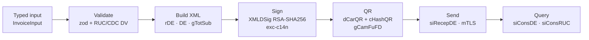

# sifen-toolkit

[](https://github.com/raullucena-dev/sifen-toolkit/actions/workflows/ci.yml)


[](LICENSE)

TypeScript tooling for **SIFEN**, Paraguay's electronic invoicing system, following the
_Manual Técnico_ v150. The package is a library plus a small Fastify service. It turns a
typed invoice into a signed `rDE` document with its QR code, and talks to the SIFEN
**test** environment.

## What is SIFEN?

SIFEN (_Sistema Integrado de Facturación Electrónica Nacional_) is the electronic
invoicing system of Paraguay's tax authority (SET). Taxpayers issue XML documents
signed with their certificate, each identified by a 44-digit CDC. They send them to
SIFEN's SOAP web services and give buyers a printed version (KuDE) with a QR code that
links back to the official record.

## Flow



## What's included

| Feature                                                                                                                                                                     | API                                                                 |
| --------------------------------------------------------------------------------------------------------------------------------------------------------------------------- | ------------------------------------------------------------------- |
| CDC: build from components with its módulo 11 DV; parse and validate                                                                                                        | `buildCdc`, `parseCdc`, `isValidCdc`                                |
| RUC check digit (módulo 11)                                                                                                                                                 | `rucCheckDigit`, `parseRuc`, `isValidRuc`                           |
| Factura Electrónica (`iTiDE=1`) XML from a zod-validated model: emitter, receiver (contribuyente or not), items at IVA 10%, 5% or exempt, PYG totals with explicit rounding | `buildInvoiceXml`, `invoiceSchema`                                  |
| Enveloped XMLDSig with a PKCS#12 or PEM certificate supplied at runtime                                                                                                     | `loadPkcs12`, `loadPem`, `signInvoiceXml`, `verifyInvoiceSignature` |
| QR URL (`dCarQR`) with the CSC-based `cHashQR`                                                                                                                              | `buildQrUrl`, `createSignedInvoice`                                 |
| SOAP client for the **test** environment over mutual TLS: `siRecepDE`, `siConsDE`, `siConsRUC`                                                                              | `SifenClient`                                                       |
| HTTP service: `POST /invoices/preview`, `POST /invoices/sign`, `GET /ruc/:ruc`, OpenAPI at `/docs`                                                                          | `src/server`                                                        |

## Quickstart

Requirements: Node 22 and pnpm (`corepack enable`).

```bash
pnpm install
pnpm test            # 125 tests; certificates are generated at test time
pnpm build           # ESM + CJS + type declarations in dist/
pnpm dev             # service on http://localhost:3000, docs at /docs
```

With Docker:

```bash
docker build -t sifen-toolkit .
docker run --rm -p 3000:3000 sifen-toolkit
# Signing and RUC lookups need a certificate and CSC, mounted at runtime:
docker run --rm -p 3000:3000 \
  -v "$PWD/secrets:/secrets:ro" \
  -e SIFEN_CERT_P12_PATH=/secrets/cert.p12 -e SIFEN_CERT_P12_PASSWORD \
  -e SIFEN_CSC_ID=0001 -e SIFEN_CSC \
  sifen-toolkit
```

| Variable                                         | Purpose                                               |
| ------------------------------------------------ | ----------------------------------------------------- |
| `SIFEN_CERT_P12_PATH`, `SIFEN_CERT_P12_PASSWORD` | PKCS#12 certificate for signing and mTLS              |
| `SIFEN_CERT_PEM_PATH`, `SIFEN_KEY_PEM_PATH`      | Alternative: PEM certificate and key                  |
| `SIFEN_CSC_ID`, `SIFEN_CSC`                      | Código de Seguridad del Contribuyente for the QR hash |
| `PORT`, `HOST`, `LOG_LEVEL`                      | Service settings                                      |

## Examples

### Check digits

```ts
import { buildCdc, parseCdc, rucCheckDigit, isValidRuc } from "sifen-toolkit";

rucCheckDigit("80000001"); // 3   (fictitious RUC)
isValidRuc("80000001-3"); // true

const cdc = buildCdc({
  tipoDocumento: 1,
  rucEmisor: "80000001",
  dvEmisor: 3,
  establecimiento: "001",
  puntoExpedicion: "001",
  numeroDocumento: "0000015",
  tipoContribuyente: 2,
  fechaEmision: "2026-10-22",
  tipoEmision: 1,
  codigoSeguridad: "123456789",
}); // "01800000013001001000001522026102211234567894"

parseCdc(cdc).numeroDocumento; // "0000015"
```

### Build, sign and add the QR

```ts
import { readFileSync } from "node:fs";
import { buildInvoiceXml, createSignedInvoice, loadPkcs12 } from "sifen-toolkit";

const invoice = {
  timbrado: {
    numero: "12345678",
    fechaInicio: "2026-01-01",
    establecimiento: "001",
    puntoExpedicion: "001",
    numeroDocumento: 15,
  },
  fechaEmision: "2026-10-22T10:00:00", // Paraguay local time
  emisor: {
    ruc: "80000001-3",
    tipoContribuyente: 2,
    razonSocial: "Empresa Ficticia S.A.",
    direccion: "Calle Ficticia",
    departamento: { codigo: 1, descripcion: "CAPITAL" },
    ciudad: { codigo: 1, descripcion: "ASUNCION (DISTRITO)" },
    telefono: "021000000",
    email: "ventas@example.com",
    actividadEconomica: { codigo: "46510", descripcion: "Comercio al por mayor" },
  },
  receptor: {
    tipo: "contribuyente",
    ruc: "80000002-1",
    tipoContribuyente: 2,
    razonSocial: "Cliente Ficticio S.R.L.",
  },
  items: [
    { codigo: "A-1", descripcion: "Producto", cantidad: 1, precioUnitario: 100000, iva: 10 },
    { codigo: "C-1", descripcion: "Exento", cantidad: 3, precioUnitario: 1000, iva: 0 },
  ],
} as const;

// Unsigned XML and totals (throws a ZodError listing every problem when input is invalid)
const preview = buildInvoiceXml(invoice);
preview.totals.dTotGralOpe.toString(); // "103000"
preview.totals.dIVA10.toString(); // "9091"

// Signed rDE with gCamFuFD/dCarQR, ready for siRecepDE
const credentials = loadPkcs12(readFileSync(process.env.CERT_PATH!), process.env.CERT_PASSWORD!);
const signed = createSignedInvoice(invoice, credentials, { id: "0001", value: process.env.CSC! });
signed.signedXml;
signed.qrUrl;
```

### Talk to SIFEN test

```ts
import { SifenClient } from "sifen-toolkit";

const client = new SifenClient({ credentials }); // test endpoints, mutual TLS
const reception = await client.sendDocument(signed.signedXml);
reception.approved; // true when dEstRes starts with "Aprobado"
reception.messages; // [{ code, message }]

await client.queryDocument(signed.cdc);
await client.queryRuc("80000002-1");
```

### HTTP service

```bash
curl -s localhost:3000/invoices/preview -H 'content-type: application/json' -d @invoice.json
# → { "cdc": "...", "xml": "<?xml ...", "totals": { "dTotGralOpe": "103000", ... } }
# Invalid input → 422 with every issue: [{ "path": "emisor.ruc", "message": "invalid RUC ..." }]

curl -s localhost:3000/invoices/sign -H 'content-type: application/json' -d @invoice.json
curl -s localhost:3000/ruc/80000002-1
```

## Testing

| Area         | What is tested                                                                                                                                                                         |
| ------------ | -------------------------------------------------------------------------------------------------------------------------------------------------------------------------------------- |
| Check digits | Hand-computed módulo 11 vectors; cross-check against an independent implementation; detection of single-digit changes (and the official algorithm's blind spot at weight-11 positions) |
| Amounts      | IVA formulas at 8 decimals, PYG totals rounded half-up, tiny amounts, sum-then-round, values on either side of half a guaraní                                                          |
| Validation   | zod rejections: wrong RUC DV, timezone in dates, emission before the timbrado, IVA 15%, fractional guaraníes, innominado rules and more                                                |
| XML          | Snapshots for both receiver types, element order, namespace, escaping                                                                                                                  |
| Signature    | Verifies with the public key, and the `SignatureValue` also verifies with plain `node:crypto`; tampering, wrong certificate, duplicate signatures and wrapping are rejected            |
| QR           | A fixed `cHashQR` vector and the hex encodings                                                                                                                                         |
| SOAP         | Mocked SIFEN (nock): approvals, rejections, faults, HTTP errors, timeouts; plus a **real local HTTPS server that requires a client certificate**, to prove mutual TLS                  |
| Service      | Every endpoint and error mapping through `fastify.inject`, and the OpenAPI document                                                                                                    |
| Integration  | `test/integration.test.ts` runs against SIFEN test only when `SIFEN_TEST_CERT_P12_PATH` and `SIFEN_TEST_RUC` are set                                                                   |

Coverage is enforced at 85% in CI (currently about 99% of lines and 90% of branches).
Official XSDs are **not** committed. `pnpm xsd:download` fetches them into a gitignored
`xsd/` folder and `pnpm xsd:validate` checks generated documents with `xmllint`. In CI,
signed sample invoices for both receiver types validate against `siRecepDE_v150.xsd`.
That proves structure. Business rules checked by SIFEN on reception are tracked in
[docs/assumptions.md](docs/assumptions.md).

## Not included

Out of scope on purpose:

- Batch sending (lotes, `siRecepLoteDE`) and batch queries
- Events: cancelación, inutilización, conformidad and the other receiver events
- Notas de crédito / débito, nota de remisión, autofactura and other document types
- Credit sales, card and cheque payments, discounts, advances, foreign currency, other
  units of measure, and partially exempt or exonerated IVA
- KuDE (printable representation) generation
- Production hardening: production endpoints, retries and back-off, contingency mode,
  persistence, idempotency, HSM/KMS signing, rate limiting and authentication on the
  HTTP service

Rules I could not confirm are implemented conservatively and listed in
[docs/assumptions.md](docs/assumptions.md).

## Design decisions

| Decision                                                                | Why                                                                             | ADR                                                          |
| ----------------------------------------------------------------------- | ------------------------------------------------------------------------------- | ------------------------------------------------------------ |
| Library plus a thin, separate service                                   | Isolates the signing key and the SET's change cycle from business systems       | [0001](docs/adr/0001-separate-fiscal-integration-service.md) |
| Keys only at runtime, from mounted files; never in requests or the repo | Whoever holds the key can issue tax documents                                   | [0002](docs/adr/0002-signing-strategy-and-key-handling.md)   |
| QR appended as text after signing                                       | The signed bytes are never re-serialised                                        | [0002](docs/adr/0002-signing-strategy-and-key-handling.md)   |
| Test environment by default; other hosts need an explicit flag          | Production mistakes need cancellation events, which are out of scope            | [0003](docs/adr/0003-test-environment-only-by-default.md)    |
| zod as the only validator (OpenAPI generated from the same schema)      | One source of truth; every issue is reported at once                            |                                                              |
| bigint fixed-point decimal for amounts                                  | No binary floating point in tax calculations                                    |                                                              |
| Code→description catalogs fixed in code                                 | SIFEN checks descriptions against codes, so callers can't send mismatched pairs |                                                              |
| Conservative when unsure, with a documented TODO                        | A wrong invented rule is worse than a rejected input                            | [assumptions](docs/assumptions.md)                           |

## Project structure

```
src/
  core/       modulo11, RUC, CDC, fixed-point Decimal
  invoice/    catalogs, zod schema, IVA/totals, XML builder, sign + QR pipeline
  signing/    PKCS#12/PEM loading, XMLDSig sign/verify
  qr/         dCarQR + cHashQR
  soap/       envelopes, response parsers, mTLS client (test env)
  server/     Fastify app, config, entry point
scripts/      XSD download and validation (official files never committed)
test/         vitest suites; certificates are generated at test time
docs/         ADRs and assumptions
```

## License

[MIT](LICENSE)

---

## Resumen en español

**sifen-toolkit** es una librería en TypeScript, con un pequeño servicio Fastify, para
la facturación electrónica de Paraguay (SIFEN, Manual Técnico v150). Hace lo siguiente:

- Genera y valida el CDC de 44 dígitos y el dígito verificador del RUC (módulo 11).
- Arma el XML de una Factura Electrónica a partir de un modelo validado con zod, con
  IVA 10%, 5% y exento y totales en guaraníes con redondeo explícito.
- Firma el documento con XMLDSig (RSA-SHA256), usando un certificado PKCS#12 o PEM que
  se entrega en tiempo de ejecución.
- Genera la URL del QR con el hash del CSC.
- Consume los servicios SOAP del ambiente de **pruebas** (siRecepDE, siConsDE,
  siConsRUC) con TLS mutuo.

No incluye lotes, eventos, notas de crédito o débito, remisión, autofactura ni
endurecimiento para producción. Las reglas que no pude confirmar están documentadas en
`docs/assumptions.md`.

---

Production-grade SIFEN integrations (all document types, events, batching) available as a consulting service — contact rjlucen@gmail.com
